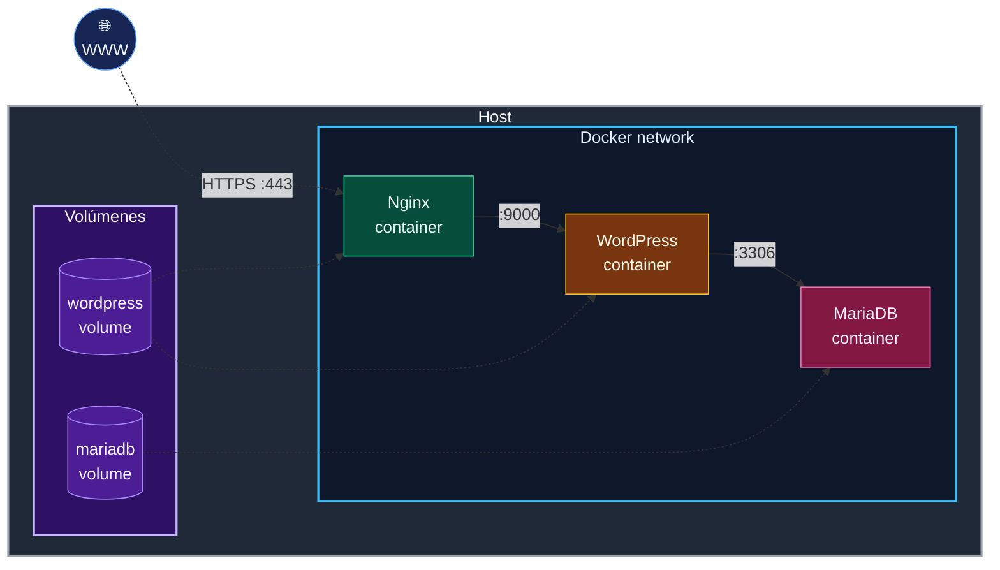

# 42_Inception

Proyecto Inception de 42.

## Vista rápida



## Documentación

Documentación técnica del proyecto:

- [Nginx](docs/nginx.md): qué es, cómo funciona como servidor HTTPS y cómo se conecta con WordPress/PHP-FPM.
- [WordPress](docs/wordpress.md): qué es, cómo genera la web dinámica y cómo usa PHP-FPM, MariaDB y el volumen compartido.
- [PHP](docs/php.md): qué es PHP, qué es PHP-FPM y por qué el contenedor WordPress usa `php83-fpm`.
- [OpenSSL](docs/openssl.md): cómo se genera el certificado autofirmado usado por Nginx.
- [/etc/hosts](docs/hosts.md): qué línea añadir para que `ide-dieg.42.fr` apunte al Nginx local.
- [Alpine Linux](docs/alpine.md): por qué se usa como base de los contenedores y cómo funciona `apk`.
- [MariaDB](docs/mariadb.md): qué es, cómo guarda los datos de WordPress y cómo se inicializa la base del sitio.
- [Secrets](docs/secrets.md): cómo guardar contraseñas fuera de las imágenes y cargarlas en los contenedores.
- [Docker](docs/docker.md): guía general sobre instalación, uso básico y conceptos como contenedores, imágenes, Compose, volúmenes y redes.
- [Documentación para desarrolladores](DEV_DOC.md): vista técnica del flujo de trabajo y enlaces útiles.
- [Documentación de usuario](USER_DOC.md): explicación simple de la pila desde el punto de vista de uso.

Los diagramas están escritos con Mermaid. Si tu visor Markdown no los renderiza,
instala soporte Mermaid o usa una versión reciente de VS Code.

## Uso rápido

Construir y ejecutar el contenedor Nginx principal:

```sh
make
```

Probar el módulo de Nginx de forma aislada:

```sh
cd srcs/requirements/nginx
make
```

El Makefile principal publica HTTPS en `443`. El Makefile del módulo Nginx
publica HTTPS en `8088`.
