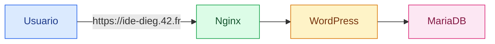

# Documentación de usuario

[← README](README.md)

Este documento está pensado para explicar la pila desde el punto de vista de una
persona que quiere usar o administrar el servicio.

## Qué servicios hay



## Qué debería explicar este documento

- Cómo iniciar y detener el proyecto.
- Cómo acceder al sitio web.
- Cómo acceder al panel de administración.
- Dónde se guardan o gestionan las credenciales.
- Cómo comprobar que los servicios funcionan correctamente.

## Credenciales y datos

La configuración no sensible está en:

```text
srcs/.env
```

Las contraseñas y credenciales privadas están en:

```text
secrets/db_password.txt
secrets/db_root_password.txt
secrets/credentials.txt
```

MariaDB usa `db_password.txt` y `db_root_password.txt` para crear la base
`wordpress` y el usuario `wp_user`. WordPress usa `credentials.txt` para
instalar el sitio y crear sus usuarios por defecto.

Los archivos del sitio se guardan en el volumen `wordpress_data`. La base de
datos real se guarda en el volumen `mariadb_data`.

## Documentación relacionada

- [Nginx](docs/nginx.md)
- [MariaDB](docs/mariadb.md)
- [Secrets](docs/secrets.md)
- [Docker Compose](docs/docker-compose.md)
