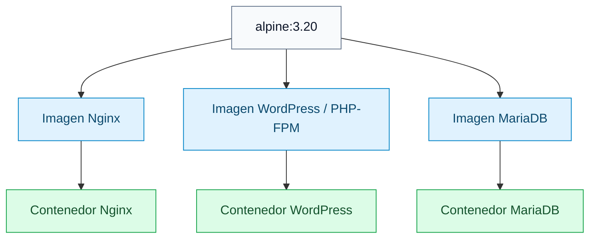
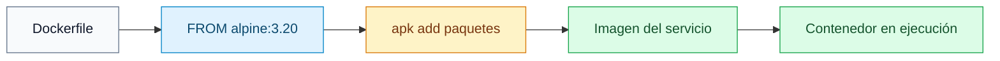

# Alpine Linux

[← README](../README.md)

## Qué es

Alpine Linux es una distribución de Linux muy pequeña.

Se usa mucho en Docker porque permite crear imágenes ligeras: descargan rápido,
ocupan poco espacio y tienen solo lo necesario para ejecutar el servicio.

En este proyecto, Alpine es la base de los contenedores de Nginx, WordPress y
MariaDB.



## Por qué se usa en Docker

Una imagen Docker contiene un sistema de archivos completo para ejecutar una
aplicación. Si la imagen base es pequeña, el contenedor también suele ser más
ligero.

Alpine ayuda porque:

- Tiene un tamaño reducido.
- Usa `apk` como gestor de paquetes.
- Arranca rápido.
- Encaja bien con servicios pequeños y separados.

La idea de Inception es precisamente esa: cada servicio vive en su propio
contenedor.

## Alpine en este proyecto

Los Dockerfiles usan:

```dockerfile
FROM alpine:3.20
```

Eso significa que cada imagen empieza desde Alpine 3.20.

Después cada servicio instala solo lo que necesita.

Nginx:

```dockerfile
RUN apk update && apk add nginx openssl
```

WordPress/PHP-FPM:

```dockerfile
RUN apk add --no-cache ca-certificates curl tar php83-fpm php83-mysqli
```

MariaDB:

```dockerfile
RUN apk add --no-cache mariadb
```

Cada contenedor parte de la misma base, pero instala paquetes distintos.

`--no-cache` evita guardar la caché del índice de paquetes dentro de la imagen.
Es una forma sencilla de mantener imágenes más pequeñas.

## Cómo funciona `apk`

`apk` es el gestor de paquetes de Alpine. Sirve para instalar, actualizar y
buscar programas.

Actualizar el índice de paquetes:

```sh
apk update
```

Instalar paquetes:

```sh
apk add nginx openssl
```

Buscar un paquete:

```sh
apk search nginx
```

Ver paquetes instalados:

```sh
apk info
```

En un Dockerfile se suele ver todo en una instrucción:

```dockerfile
RUN apk update && apk add nginx openssl
```

Primero se actualiza la lista de paquetes disponibles y luego se instalan los
paquetes necesarios.

## Diferencia entre imagen y contenedor

Una imagen es la plantilla. Por ejemplo, la imagen `nginx` que construye el
Makefile.

Un contenedor es una ejecución concreta de esa imagen. Por ejemplo, el contenedor
llamado `nginx` que se arranca con `docker run`.

En este proyecto:

1. Docker lee el `Dockerfile`.
2. Descarga o usa la imagen base `alpine:3.20`.
3. Instala paquetes con `apk`.
4. Copia archivos de configuración y herramientas.
5. Crea una imagen propia.
6. Ejecuta un contenedor desde esa imagen.



## Ejemplo con Nginx

El Dockerfile de Nginx hace esto:

```dockerfile
FROM alpine:3.20
RUN apk update && apk add nginx openssl
RUN mkdir -p /run/nginx /etc/nginx/ssl
COPY conf/nginx.conf /etc/nginx/http.d/default.conf
COPY tools/ /usr/share/nginx/html/
EXPOSE 443
CMD ["nginx", "-g", "daemon off;"]
```

Explicado en simple:

1. Empieza desde Alpine.
2. Instala Nginx y OpenSSL.
3. Crea carpetas que Nginx necesita.
4. Copia la configuración de Nginx.
5. Copia los archivos web.
6. Declara que el servicio usa el puerto `443`.
7. Arranca Nginx.

## Comandos útiles

Construir la imagen principal de Nginx:

```sh
make
```

Entrar en el contenedor:

```sh
docker exec -it nginx sh
```

Alpine suele usar `sh` como shell básica. No siempre tendrá `bash` instalado.

Ver la versión de Alpine dentro del contenedor:

```sh
cat /etc/alpine-release
```

Ver paquetes instalados:

```sh
apk info
```

Instalar una herramienta temporal dentro de un contenedor para depurar:

```sh
apk add curl
```

Esto sirve para pruebas rápidas, pero no es permanente. Si el contenedor se
recrea, se pierde. Si una herramienta hace falta siempre, debe instalarse en el
Dockerfile.

## Buenas prácticas para este proyecto

Instala en cada imagen solo lo necesario para ese servicio.

Mantén la configuración en archivos versionados, como:

```text
srcs/requirements/nginx/conf/nginx.conf
```

No configures cosas importantes manualmente dentro de un contenedor ya arrancado.
Si algo debe existir siempre, ponlo en el Dockerfile o en un script copiado a la
imagen.

Usa contenedores separados para responsabilidades separadas:

- Nginx sirve HTTPS y reenvía PHP.
- WordPress/PHP-FPM ejecuta PHP.
- MariaDB guarda los datos.

## Errores comunes

Si un comando como `bash` no existe, usa `sh`:

```sh
docker exec -it nginx sh
```

Si un paquete no se encuentra, prueba primero:

```sh
apk update
```

Si instalas algo a mano dentro del contenedor y luego desaparece, es normal: los
cambios manuales no forman parte de la imagen. Añádelo al Dockerfile.
