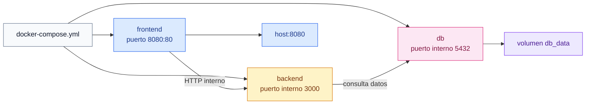

# Docker Compose

[← Docker](docker.md)

## Qué es

Docker Compose es una herramienta para definir y ejecutar varios contenedores a
la vez.

En vez de escribir muchos comandos `docker run`, defines los servicios en un
archivo YAML y luego levantas todo con un solo comando.

El archivo típico se llama:

```text
docker-compose.yml
```

## Por qué se usa

Muchas aplicaciones no son un solo proceso. Suelen tener varios servicios que
trabajan juntos:


Compose permite describir:

- Qué servicios existen.
- Cómo se construye cada imagen.
- Qué puertos se publican.
- Qué volúmenes se conectan.
- Qué redes usan los servicios.
- Qué variables de entorno necesita cada servicio.

## Diagrama simple



## Ejemplo genérico

Un Compose básico con frontend, backend y base de datos podría tener esta forma:

```yaml
services:
  frontend:
    build: ./frontend
    container_name: frontend
    ports:
      - "8080:80"
    depends_on:
      - backend

  backend:
    build: ./backend
    container_name: backend
    expose:
      - "3000"
    depends_on:
      - db

  db:
    image: postgres:16
    container_name: db
    expose:
      - "5432"
    volumes:
      - db_data:/var/lib/postgresql/data

volumes:
  db_data:
```

La idea importante es que todos los servicios quedan descritos en un único
archivo.

## Comandos básicos

Levantar servicios:

```sh
docker compose up
```

Levantar y reconstruir imágenes:

```sh
docker compose up --build
```

Levantar en segundo plano:

```sh
docker compose up -d
```

Ver servicios:

```sh
docker compose ps
```

Ver logs:

```sh
docker compose logs
```

Ver logs de un servicio:

```sh
docker compose logs frontend
```

Parar y eliminar contenedores/redes creados por Compose:

```sh
docker compose down
```

Parar y eliminar también volúmenes:

```sh
docker compose down -v
```

Cuidado con `down -v`: elimina volúmenes de la aplicación, así que puede borrar
datos persistentes como los de una base de datos.

Ejecutar un comando dentro de un servicio:

```sh
docker compose exec frontend sh
```

Validar la configuración:

```sh
docker compose config
```

## `ports` frente a `expose`

`ports` publica un puerto hacia la máquina host.

Ejemplo:

```yaml
ports:
  - "8080:80"
```

Significa:

el puerto `8080` de la máquina host apunta al puerto `80` del contenedor.

`expose` no publica el puerto hacia fuera. En Compose sirve sobre todo para
documentar qué puerto interno usa el servicio; los servicios de la misma red ya
pueden hablar entre ellos usando el nombre del servicio y el puerto correcto.

En general:

- El servicio público, como `frontend` o `web`, suele usar `ports`.
- Los servicios internos, como `backend`, pueden usar `expose`.
- La base de datos normalmente no se publica al host si solo la usa la aplicación.

## `depends_on`

`depends_on` indica orden de arranque básico.

Ejemplo:

```yaml
depends_on:
  - backend
```

Esto hace que Compose arranque `backend` antes que el servicio que depende de
él.


Importante: no garantiza que `backend` ya esté listo para aceptar conexiones.
Solo controla el orden de arranque. Para servicios reales se pueden usar
`healthcheck` o scripts de espera.

## Archivo de Compose

Un archivo Compose define servicios, redes y volúmenes. Puede llamarse:

```text
compose.yaml
compose.yml
docker-compose.yml
```

Si el archivo está vacío, Compose no tiene servicios que levantar. Primero hay
que definir al menos un servicio:

```yaml
services:
  web:
    image: nginx:latest
```

## Buenas prácticas

Usa nombres de servicio claros: `web`, `backend`, `db`.

Publica hacia el host solo lo necesario.

Guarda datos persistentes en volúmenes.

Usa una red propia para la aplicación.

No guardes contraseñas directamente en el Compose si puedes usar `.env` o
secretos.

## Errores comunes

Si un servicio no encuentra a otro, revisa que ambos estén en la misma red y que
el nombre del servicio sea correcto.

Si una aplicación no conecta con la base de datos, revisa el nombre de host,
usuario, contraseña y nombre de base de datos.

Si un cambio de Dockerfile no aparece, levanta con:

```sh
docker compose up --build
```

Si quieres empezar limpio, puedes usar:

```sh
docker compose down
```
