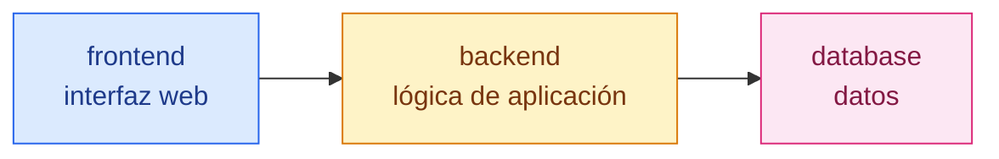
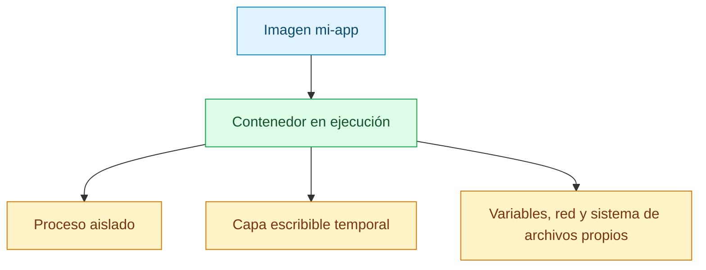

# Contenedores Docker

[← Docker](docker.md)

## Qué es un contenedor

Un contenedor es un proceso aislado.

En palabras simples: es como ejecutar una aplicación dentro de una caja. La
aplicación ve sus propios archivos, sus propias variables de entorno, sus propias
redes y sus propios procesos, pero comparte el kernel del sistema con la máquina
host.

En una aplicación con varios servicios, lo habitual es tener un contenedor por
responsabilidad:



## Por qué se usan

Los contenedores se usan porque hacen que cada servicio sea más fácil de aislar,
probar y reconstruir.

Ventajas:

- Evitan instalar todas las dependencias directamente en la máquina.
- Reducen conflictos entre versiones.
- Permiten repetir el entorno en otra máquina.
- Separan responsabilidades.
- Se crean y se destruyen rápido.

## Cómo funciona un contenedor

Un contenedor nace desde una imagen.



La imagen contiene los archivos base. El contenedor añade una capa escribible
encima, donde ocurren los cambios mientras está vivo.

Si borras el contenedor, esa capa escribible desaparece. Por eso los datos
importantes deben ir en volúmenes.

## Contenedor frente a máquina virtual

Una máquina virtual incluye un sistema operativo completo con su propio kernel.
Un contenedor comparte el kernel de la máquina host:

```mermaid
flowchart TB
    subgraph VM["Máquina virtual"]
        VMHardware["Hardware"] --> VMHost["Sistema host"]
        VMHost --> Hypervisor["Hipervisor"]
        Hypervisor --> GuestOS["Sistema operativo invitado + kernel"]
        GuestOS --> VMApp["Aplicación"]
    end

    subgraph Container["Contenedor"]
        CHardware["Hardware"] --> CHost["Sistema host + kernel"]
        CHost --> Docker["Docker"]
        Docker --> CProcess["Proceso aislado"]
    end

    classDef hardware fill:#f8fafc,stroke:#64748b,color:#0f172a
    classDef host fill:#e0f2fe,stroke:#0284c7,color:#0c4a6e
    classDef vm fill:#fee2e2,stroke:#dc2626,color:#7f1d1d
    classDef container fill:#dcfce7,stroke:#16a34a,color:#14532d
    class VMHardware,CHardware hardware
    class VMHost,CHost host
    class Hypervisor,GuestOS,VMApp vm
    class Docker,CProcess container
```



Diferencias principales:

| Tema | Contenedor | Máquina virtual |
| --- | --- | --- |
| Arranque | Rápido | Más lento |
| Tamaño | Ligero | Más pesado |
| Kernel | Comparte el del host | Tiene el suyo |
| Aislamiento | A nivel de proceso | A nivel de sistema completo |
| Uso típico | Servicios y aplicaciones | Sistemas completos |

No son enemigos. Muchas veces Docker corre dentro de una máquina virtual, sobre
todo en Docker Desktop o en entornos cloud.

## Ciclo de vida

Un contenedor puede estar:

- Creado.
- En ejecución.
- Parado.
- Eliminado.

Comandos útiles:

```sh
docker run alpine:3.20 echo "hola"
docker ps
docker ps -a
docker stop <contenedor>
docker start <contenedor>
docker rm <contenedor>
```

`docker run` crea y arranca un contenedor.

`docker stop` lo para.

`docker start` arranca uno que ya existía.

`docker rm` elimina el contenedor.

## Ejemplo simple

Ejecutar Alpine y abrir una shell:

```sh
docker run -it alpine:3.20 sh
```

Dentro del contenedor:

```sh
cat /etc/alpine-release
exit
```

El contenedor tiene su propio sistema de archivos. No estás instalando Alpine en
tu máquina principal; lo estás ejecutando dentro de Docker.

## Ejemplo con un servidor web

Construir y ejecutar una imagen propia de Nginx:

```sh
docker build -t mi-nginx .
docker run --name mi-nginx -p 8080:80 mi-nginx
```

Eso construye una imagen llamada `mi-nginx` y ejecuta un contenedor basado en
ella.

Entrar en el contenedor:

```sh
docker exec -it mi-nginx sh
```

Ver sus logs:

```sh
docker logs mi-nginx
```

## Buenas prácticas

Un contenedor debería tener una responsabilidad clara.

En una aplicación bien separada:

- El servidor web no debería ejecutar la base de datos.
- La base de datos no debería servir la interfaz pública.
- Los datos persistentes no deberían quedarse solo en la capa temporal del
  contenedor.

Si un contenedor necesita guardar datos importantes, usa un volumen.

Si un contenedor necesita hablar con otro, usa una red de Docker.

Si un contenedor necesita recibir tráfico desde fuera, publica un puerto.

## Errores comunes

Si el contenedor se cierra al arrancar, puede que su proceso principal haya
terminado.

Si no puedes entrar con `bash`, prueba con `sh`:

```sh
docker exec -it mi-nginx sh
```

Si pierdes datos al borrar un contenedor, probablemente estaban dentro de la capa
escribible del contenedor y no en un volumen.

Si dos contenedores no se encuentran por nombre, probablemente no están en la
misma red de Docker.
