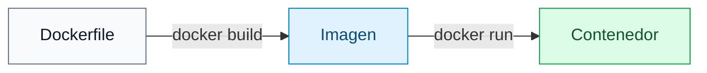
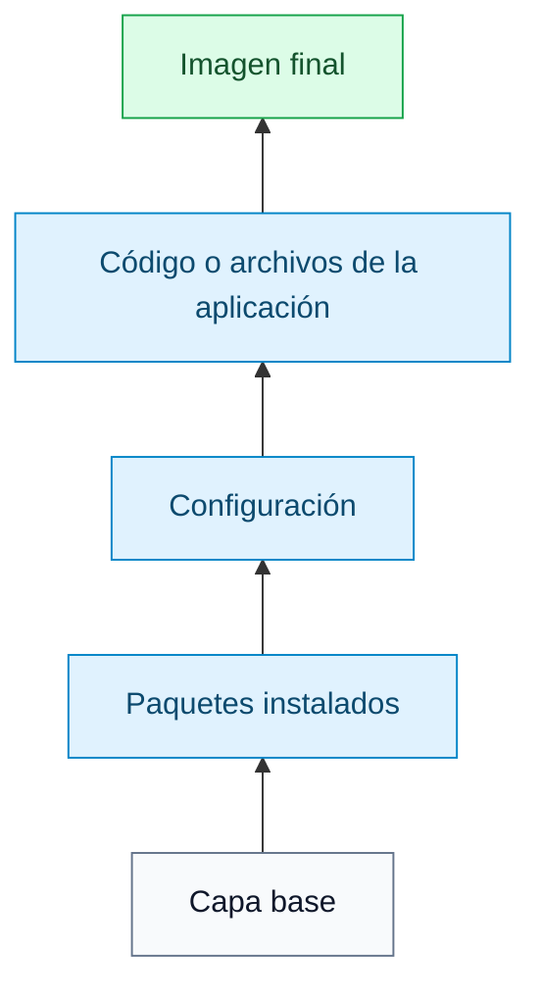
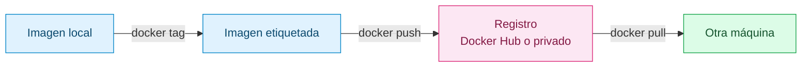

# Imágenes Docker

[← Docker](docker.md)

## Qué es una imagen

Una imagen Docker es una plantilla para crear contenedores.

En palabras simples: una imagen contiene los archivos, programas, librerías y
configuración que necesita una aplicación para arrancar.

Un contenedor es una imagen ejecutándose.



## Imagen frente a contenedor

La imagen es fija. No se ejecuta por sí sola.

El contenedor es una instancia viva de esa imagen.

Ejemplo:

```text
Imagen: alpine:3.20
Contenedor 1: alpine ejecutando sh
Contenedor 2: alpine ejecutando echo "hola"
```

Los dos contenedores pueden salir de la misma imagen, pero son ejecuciones
distintas.

## Cómo se descargan

Las imágenes se descargan normalmente desde un registro. El registro más común
es Docker Hub.

Descargar Alpine:

```sh
docker pull alpine:3.20
```

Descargar Nginx oficial:

```sh
docker pull nginx:latest
```

Ver imágenes descargadas:

```sh
docker images
```

## Cómo se crean

Las imágenes se suelen crear con un Dockerfile.

Un Dockerfile es una receta.

Ejemplo simple:

```dockerfile
FROM alpine:3.20

RUN apk add --no-cache nginx

CMD ["nginx", "-g", "daemon off;"]
```

Explicado:

1. `FROM` indica la imagen base.
2. `RUN` ejecuta comandos durante la construcción.
3. `CMD` indica qué proceso se ejecuta cuando arranca el contenedor.

## Ejemplo de imagen propia

Imagina una aplicación web sencilla con esta estructura:

```text
mi-app/
  Dockerfile
  index.html
```

Dockerfile:

```dockerfile
FROM nginx:latest
COPY index.html /usr/share/nginx/html/index.html
```

Construcción:

```sh
docker build -t mi-web mi-app
```

Ese comando lee `mi-app/Dockerfile` y crea una imagen llamada `mi-web`.

## Cómo se construyen

Comando básico:

```sh
docker build -t nombre:tag ruta
```

Ejemplo:

```sh
docker build -t mi-app:1.0 .
```

`-t` asigna nombre y etiqueta.

La ruta final indica el contexto de construcción. Docker solo puede copiar
archivos que estén dentro de ese contexto.

## Capas de una imagen

Una imagen está formada por capas.

Cada instrucción importante del Dockerfile crea una capa nueva:



Docker reutiliza capas si no han cambiado. Eso hace que las reconstrucciones
sean más rápidas.

## Cómo se almacenan

Docker guarda las imágenes localmente en su propio almacenamiento interno.

No conviene editar esos archivos a mano. Se gestionan con comandos:

```sh
docker images
docker image inspect mi-app
docker image history mi-app
docker rmi mi-app
```

`docker image history` ayuda a ver qué capas forman una imagen.

## Cómo se comparten

Para compartir una imagen normalmente se usa un registro, como Docker Hub o un
registro privado.



Flujo típico:

```sh
docker tag mi-app:1.0 usuario/mi-app:1.0
docker login
docker push usuario/mi-app:1.0
```

Otra persona podría descargarla con:

```sh
docker pull usuario/mi-app:1.0
```

En muchos proyectos no hace falta publicar las imágenes; basta con compartir los
Dockerfiles para que otras personas puedan reconstruirlas.

## Tags

Un tag es una etiqueta de versión.

Ejemplos:

```text
alpine:3.20
nginx:latest
mi-app:1.0
```

`latest` no siempre significa "la versión más segura para producción". Solo es
una etiqueta. Para proyectos reproducibles, suele ser mejor usar versiones
concretas como `alpine:3.20`.

## Buenas prácticas

Usa imágenes base pequeñas cuando tenga sentido, como Alpine.

Instala solo lo necesario.

Evita guardar contraseñas o secretos dentro de una imagen.

Usa `.dockerignore` para no copiar archivos innecesarios al contexto.

Ordena el Dockerfile para aprovechar la caché.

Usa tags claros.

## Errores comunes

Si `COPY` falla, revisa que el archivo esté dentro del contexto de construcción.

Si una imagen no se actualiza, puede que Docker esté usando caché. Puedes probar:

```sh
docker build --no-cache -t mi-app .
```

Si una imagen ocupa mucho, revisa qué paquetes instalas y si estás copiando
archivos innecesarios.
