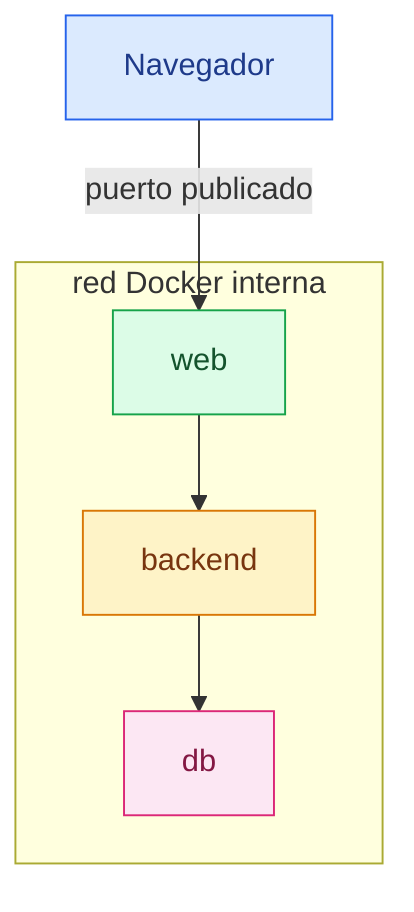
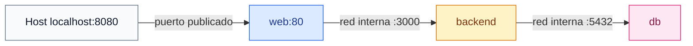

# Redes Docker

[← Docker](docker.md)

## Qué es una red Docker

Una red Docker permite que los contenedores se comuniquen entre sí y, si hace
falta, con el exterior.

En palabras simples: es el cable virtual que conecta contenedores.

En una aplicación típica, el servidor web necesita hablar con la aplicación, y
la aplicación necesita hablar con la base de datos.


## Por qué se usan

Las redes permiten aislar servicios.

Por ejemplo, normalmente no hace falta que la base de datos esté expuesta al
navegador. Solo el backend debería poder hablar con ella.

La red interna permite esto:



## Tipos de redes

Docker tiene varios drivers de red.

Los más comunes:

- `bridge`: red privada en una sola máquina. Es la más habitual para desarrollo.
- `host`: el contenedor usa directamente la red del host. Menos aislamiento.
- `none`: el contenedor no tiene red.
- `overlay`: conecta contenedores entre varios hosts, usado con Swarm.
- `macvlan`: hace que un contenedor parezca un dispositivo de la red física.
- `ipvlan`: variante avanzada para redes externas/VLANs.

Para una aplicación local con varios servicios normalmente se usa una red
`bridge` creada por Docker Compose.

## Red por defecto frente a red propia

Si ejecutas un contenedor sin indicar red, Docker lo conecta a una red `bridge`
por defecto.

Pero para proyectos con varios servicios es mejor usar una red propia.

Crear una red:

```sh
docker network create app_net
```

Ejecutar un contenedor dentro de esa red:

```sh
docker run --network app_net --name web nginx
```

Conectar un contenedor ya existente:

```sh
docker network connect app_net web
```

Desconectarlo:

```sh
docker network disconnect app_net web
```

## Resolución por nombre

En una red Docker propia, los contenedores pueden encontrarse por nombre.

Ejemplo:

- El servicio `backend` es accesible como `backend`.
- El servicio `db` es accesible como `db`.

Por ejemplo, un servicio web podría conectarse al backend con:

```text
http://backend:3000
```

El servicio web no necesita saber la IP exacta. Docker resuelve el nombre
`backend` en la red interna.

## Gestión de puertos

Hay dos ideas distintas:

- Puerto interno: el puerto dentro del contenedor.
- Puerto publicado: el puerto que se abre en la máquina host.

Ejemplo:

```sh
docker run -p 8080:80 nginx
```

Significa:

`localhost:8080` en el host apunta al puerto `80` del contenedor.

El formato es:

```text
HOST:CONTENEDOR
```

Ejemplo:

```text
8080:80
```

Significa:

el puerto `8080` del host apunta al puerto `80` del contenedor.

Así el navegador puede entrar desde la máquina host.

## `EXPOSE` frente a `ports`

`EXPOSE` en un Dockerfile documenta que el contenedor espera usar un puerto.

Ejemplo:

```dockerfile
EXPOSE 80
```

Pero `EXPOSE` no publica el puerto automáticamente en la máquina host.

Para publicar se usa:

```sh
docker run -p 8080:80 nginx
```

O en Compose:

```yaml
ports:
  - "8080:80"
```

## `ports` frente a comunicación interna

No todos los servicios deben publicar puertos al host.

En una aplicación típica:

- El servidor web publica un puerto porque recibe tráfico del navegador.
- El backend escucha en un puerto interno, pero solo el servidor web debería acceder.
- La base de datos escucha en un puerto interno, pero solo el backend debería acceder.

Diagrama de puertos:



## Redes en Docker Compose

Ejemplo:

```yaml
services:
  web:
    networks:
      - app_net

  backend:
    networks:
      - app_net

  db:
    networks:
      - app_net

networks:
  app_net:
    driver: bridge
```

Compose crea la red y conecta los servicios.

Dentro de esa red, `web` puede resolver `backend`, y `backend` puede resolver
`db`.

## Comandos útiles

Listar redes:

```sh
docker network ls
```

Crear una red:

```sh
docker network create app_net
```

Inspeccionar una red:

```sh
docker network inspect app_net
```

Eliminar una red:

```sh
docker network rm app_net
```

Probar resolución entre contenedores:

```sh
docker exec -it web sh
```

Dentro del contenedor:

```sh
ping backend
```

Puede que algunas imágenes mínimas no traigan `ping` instalado. En ese caso se
pueden usar herramientas como `nc`, `curl` o instalar temporalmente paquetes para
depurar.

## Errores comunes

Si un contenedor no puede resolver otro por nombre, revisa que estén en la misma
red.

Si el navegador no puede entrar, revisa que el puerto esté publicado con
`ports` o `-p`.

Si una base de datos es accesible desde fuera sin querer, probablemente se
publicó su puerto al host. Normalmente no hace falta publicar una base de datos
local si solo la usa otro contenedor.

Si usas `localhost` desde un contenedor, recuerda que `localhost` es el propio
contenedor, no la máquina host ni otro servicio.

## Regla fácil

Usa nombres de servicio para comunicación interna:


Usa puertos publicados solo para comunicación desde fuera:


