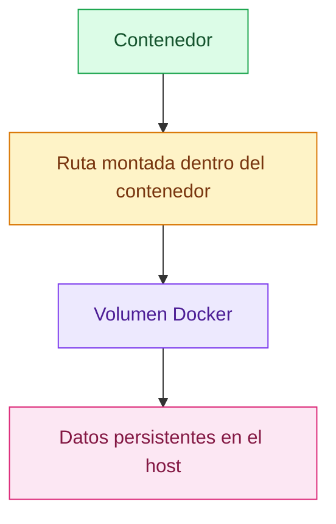
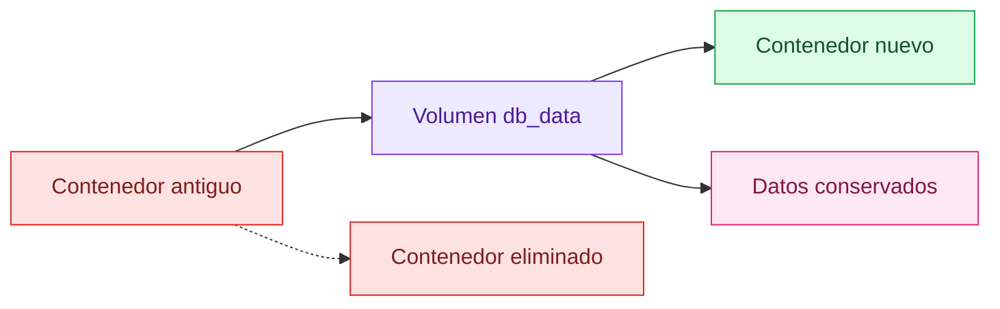
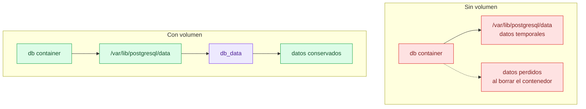

# Volúmenes Docker

[← Docker](docker.md)

## Qué es un volumen

Un volumen es almacenamiento persistente gestionado por Docker.

En palabras simples: es una carpeta especial que Docker conecta a un contenedor
para guardar datos que no deben desaparecer cuando el contenedor se borra.

Esto es muy importante para bases de datos, archivos subidos por usuarios,
cachés persistentes o cualquier dato que no quieras perder.



## Por qué hacen falta

Los contenedores son temporales. Puedes pararlos, borrarlos y recrearlos.

Pero una base de datos no debería perder sus datos cada vez que recreas el
contenedor.

Sin volumen:

los datos escritos dentro del contenedor desaparecen al borrarlo.

Con volumen:

el contenedor puede desaparecer, pero el volumen sigue existiendo.



## Volumen frente a almacenamiento normal

Un volumen no es un disco virtual completo como el de una máquina virtual.

Es una zona de almacenamiento del host que Docker gestiona y monta dentro de un
contenedor.

| Tipo | Quién lo gestiona | Uso típico |
| --- | --- | --- |
| Capa del contenedor | Docker | Cambios temporales |
| Volumen | Docker | Datos persistentes |
| Bind mount | Usuario/host | Compartir carpetas concretas |
| Disco virtual | Hipervisor/VM | Sistema completo de una máquina virtual |

## Tipos principales

Volumen con nombre:

```sh
docker volume create db_data
```

Es el más habitual para bases de datos.

Volumen anónimo:

```sh
docker run -v /data alpine
```

Docker crea un volumen con un nombre automático. Es útil en algunos casos, pero
es más difícil de identificar.

Bind mount:

```sh
docker run -v "$PWD":/app alpine
```

Monta una carpeta concreta del host dentro del contenedor. Es cómodo para
desarrollo, pero depende mucho de la estructura de carpetas de la máquina.

tmpfs:

```sh
docker run --tmpfs /tmp alpine
```

Guarda datos solo en memoria. Al parar el contenedor, desaparecen.

## Cómo se conectan

Con `docker run`:

```sh
docker volume create db_data
docker run -v db_data:/var/lib/postgresql/data postgres:16
```

Significa:

el volumen `db_data` se monta en `/var/lib/postgresql/data` dentro del
contenedor.

Con `--mount`, que es más explícito:

```sh
docker run \
  --mount type=volume,source=db_data,target=/var/lib/postgresql/data \
  postgres:16
```

## Volúmenes en Docker Compose

Ejemplo con una base de datos:

```yaml
services:
  db:
    image: postgres:16
    volumes:
      - db_data:/var/lib/postgresql/data

volumes:
  db_data:
```

Cuando Compose levanta la aplicación, crea el volumen si no existe.

Cuando el contenedor se recrea, Compose vuelve a conectar el mismo volumen.

## Comandos útiles

Crear un volumen:

```sh
docker volume create db_data
```

Listar volúmenes:

```sh
docker volume ls
```

Inspeccionar un volumen:

```sh
docker volume inspect db_data
```

Eliminar un volumen:

```sh
docker volume rm db_data
```

Eliminar volúmenes sin uso:

```sh
docker volume prune
```

Cuidado: si eliminas el volumen de una base de datos, puedes perder sus datos.

## Ejemplo con una base de datos

Muchas bases de datos guardan sus datos en una ruta interna concreta. Por
ejemplo, PostgreSQL suele usar:

```text
/var/lib/postgresql/data
```

El volumen se conecta a esa ruta:

```yaml
services:
  db:
    volumes:
      - db_data:/var/lib/postgresql/data

volumes:
  db_data:
```

Así, aunque se borre el contenedor `db`, los datos pueden seguir en `db_data`.

## Volúmenes y permisos

Los permisos importan.

Si la base de datos corre con un usuario interno concreto, ese usuario necesita
poder escribir en su directorio de datos.

Si ves errores de permisos, revisa:

- Usuario con el que arranca la base de datos.
- Propietario del directorio de datos.
- Si el volumen está montado en la ruta correcta.

## Buenas prácticas

Usa volúmenes para datos de bases de datos.

No guardes datos importantes solo dentro del contenedor.

Pon nombres claros, como `db_data` o `uploads_data`.

Haz copias de seguridad si los datos importan.

Ten cuidado con:

```sh
docker compose down -v
docker volume prune
```

Esos comandos pueden borrar datos persistentes.

## Resumen visual


