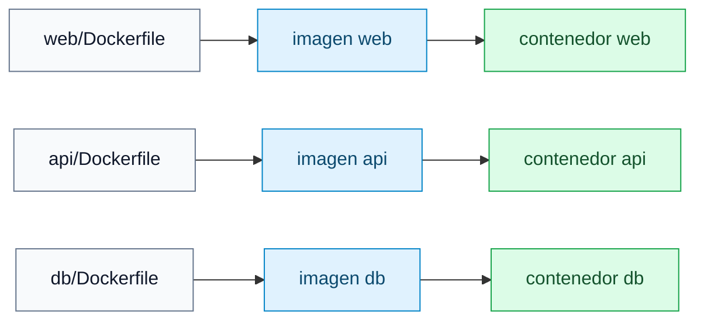
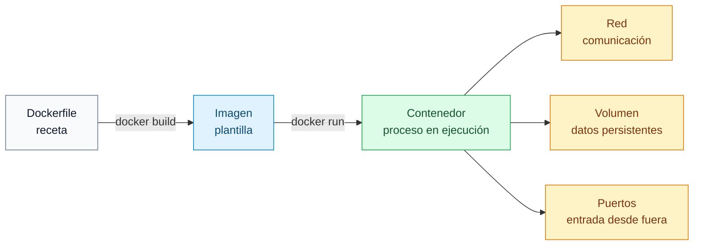

# Docker

[← README](../README.md)

## Qué es

Docker es una herramienta para ejecutar aplicaciones dentro de contenedores.

En palabras simples: Docker permite empaquetar una aplicación con todo lo que
necesita para funcionar y ejecutarla de forma aislada, sin ensuciar el sistema
principal.

Docker se usa mucho cuando una aplicación tiene varias piezas o depende de
versiones concretas de programas. Por ejemplo, una aplicación web puede tener:

Cada pieza puede vivir en su propio contenedor:


## Conceptos

- [Contenedores](docker-contenedores.md): qué son, cómo funcionan y en qué se diferencian de las máquinas virtuales.
- [Imágenes](docker-imagenes.md): cómo se crean, descargan, construyen, almacenan y comparten.
- [Docker Compose](docker-compose.md): cómo definir y levantar varios servicios con un solo fichero YAML.
- [Volúmenes](docker-volumenes.md): cómo persisten datos fuera del ciclo de vida de un contenedor.
- [Redes](docker-redes.md): cómo se comunican los contenedores entre sí y cómo funcionan los puertos.

## Por qué se usa Docker

Docker ayuda a que los entornos sean más reproducibles.

Sin Docker, habría que instalar lenguajes, servidores, bases de datos y
dependencias directamente en la máquina. En otro proyecto podrías necesitar otras
versiones, y ahí empiezan los conflictos.

Con Docker:

- Cada servicio tiene su propia imagen.
- Cada servicio corre en su propio contenedor.
- Las dependencias están descritas en Dockerfiles.
- El entorno se puede reconstruir desde cero.
- La aplicación se comporta de forma parecida en cualquier máquina con Docker.

## Cómo se instala

Hay dos formas habituales:

- Docker Desktop: cómodo para aprender y para entornos gráficos.
- Docker Engine: instalación más directa en Linux, muy usada en servidores y en
  entornos de desarrollo.

En Linux, Docker recomienda instalar Docker Engine desde su repositorio oficial.
Un resumen para Ubuntu sería:

```sh
sudo apt update
sudo apt install ca-certificates curl
sudo install -m 0755 -d /etc/apt/keyrings
sudo curl -fsSL https://download.docker.com/linux/ubuntu/gpg -o /etc/apt/keyrings/docker.asc
sudo chmod a+r /etc/apt/keyrings/docker.asc
```

Después se añade el repositorio oficial de Docker:

```sh
sudo tee /etc/apt/sources.list.d/docker.sources <<EOF
Types: deb
URIs: https://download.docker.com/linux/ubuntu
Suites: $(. /etc/os-release && echo "${UBUNTU_CODENAME:-$VERSION_CODENAME}")
Components: stable
Architectures: $(dpkg --print-architecture)
Signed-By: /etc/apt/keyrings/docker.asc
EOF
```

Y se instalan los paquetes:

```sh
sudo apt update
sudo apt install docker-ce docker-ce-cli containerd.io docker-buildx-plugin docker-compose-plugin
```

Comprobar que Docker funciona:

```sh
sudo docker run hello-world
```

Si quieres usar Docker sin escribir `sudo` todo el tiempo:

```sh
sudo groupadd docker
sudo usermod -aG docker $USER
newgrp docker
```

Importante: pertenecer al grupo `docker` da muchos permisos sobre la máquina. En
un equipo compartido hay que tratarlo con cuidado.

Documentación oficial:

- <https://docs.docker.com/engine/install/>
- <https://docs.docker.com/engine/install/ubuntu/>
- <https://docs.docker.com/engine/install/debian/>
- <https://docs.docker.com/engine/install/linux-postinstall/>
- <https://docs.docker.com/desktop/>

## Comandos básicos

Ver la versión instalada:

```sh
docker --version
docker compose version
```

Descargar una imagen:

```sh
docker pull alpine:3.20
```

Construir una imagen desde un Dockerfile:

```sh
docker build -t mi-app .
```

Ejecutar un contenedor:

```sh
docker run --name mi-app -p 8080:80 mi-app
```

Ver contenedores en ejecución:

```sh
docker ps
```

Ver todos los contenedores, también los parados:

```sh
docker ps -a
```

Parar un contenedor:

```sh
docker stop mi-app
```

Arrancar un contenedor ya creado:

```sh
docker start mi-app
```

Eliminar un contenedor parado:

```sh
docker rm mi-app
```

Ver imágenes locales:

```sh
docker images
```

Eliminar una imagen:

```sh
docker rmi mi-app
```

Ver logs:

```sh
docker logs mi-app
```

Entrar en un contenedor:

```sh
docker exec -it mi-app sh
```

## Ejemplo con varios servicios

Una aplicación real suele tener varias partes. Por ejemplo:



Para levantar todo junto se suele usar Docker Compose:

```sh
docker compose up --build
```

Compose lee un archivo YAML, crea las redes necesarias, construye las imágenes y
arranca los contenedores definidos.

## Diagrama mental



El Dockerfile describe cómo crear una imagen.

La imagen es la plantilla.

El contenedor es la imagen ejecutándose.

La red permite que los contenedores hablen entre ellos.

El volumen guarda datos que deben sobrevivir aunque el contenedor se borre.

## Comandos de limpieza

Ver cuánto espacio usa Docker:

```sh
docker system df
```

Eliminar contenedores, redes e imágenes sin uso:

```sh
docker system prune
```

Eliminar también volúmenes sin uso:

```sh
docker system prune --volumes
```

Cuidado con `prune`: puede borrar recursos que no estén siendo usados en ese
momento.

## Fuentes oficiales

- <https://docs.docker.com/engine/install/>
- <https://docs.docker.com/get-started/docker-concepts/>
- <https://docs.docker.com/compose/>
- <https://docs.docker.com/engine/storage/volumes/>
- <https://docs.docker.com/engine/network/>
