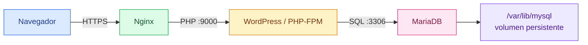
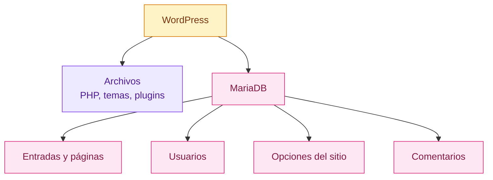
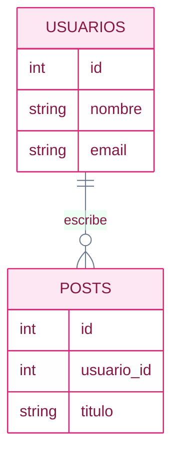

# MariaDB

[← README](../README.md)

## Qué es

MariaDB es un sistema de base de datos relacional.

En palabras simples: sirve para guardar información de forma ordenada y poder
consultarla después. En vez de guardar todo en archivos sueltos, MariaDB guarda
los datos en bases de datos, tablas, filas y columnas.

En este proyecto, MariaDB será el servicio encargado de guardar los datos de
WordPress: usuarios, entradas, comentarios, opciones de configuración y otros
datos internos.

Sin MariaDB, WordPress tendría sus archivos PHP, pero no tendría dónde guardar
el contenido del sitio. Sería como tener el motor y la carrocería, pero no el
cuaderno donde se apunta qué páginas existen, qué usuarios hay o qué título
tiene la web.

## Idea simple

Piensa en MariaDB como el almacén del proyecto:

1. WordPress necesita guardar o leer información.
2. WordPress se conecta a MariaDB.
3. WordPress envía una consulta SQL.
4. MariaDB busca, inserta, actualiza o borra datos.
5. MariaDB devuelve el resultado a WordPress.

El usuario no entra directamente a MariaDB desde el navegador. El flujo normal
es:



## Por qué WordPress necesita MariaDB

WordPress no es solo una carpeta con archivos PHP.

Tiene dos partes:

- Archivos de WordPress: el código PHP, temas, plugins e imágenes.
- Datos de WordPress: entradas, páginas, usuarios, comentarios y configuración.

Los archivos viven en el volumen de WordPress:

```text
/var/www/html
```

Los datos viven en MariaDB:

```text
/var/lib/mysql
```

Por ejemplo, cuando creas una entrada en WordPress, no se crea un archivo HTML
nuevo por cada entrada. WordPress guarda esa entrada en la base de datos. Luego,
cuando alguien visita la web, WordPress lee esa entrada desde MariaDB y genera el
HTML en ese momento.



Algunos ejemplos de datos que WordPress guarda en MariaDB:

- El título del sitio.
- La URL del sitio.
- El usuario administrador.
- Las páginas y entradas publicadas.
- Los comentarios.
- El tema activo.
- Opciones internas de WordPress.
- Ajustes de plugins.

Por eso WordPress necesita conectarse a la base de datos desde el primer arranque
real. Si no puede conectar, normalmente muestra un error de conexión a la base de
datos.

## Qué datos necesita WordPress para conectarse

WordPress no adivina dónde está MariaDB. Necesita una configuración.

Los datos importantes son:

- Host: el nombre del servicio MariaDB. En este proyecto será `mariadb`.
- Base de datos: por ejemplo `wordpress`.
- Usuario: un usuario con permisos sobre esa base de datos.
- Contraseña: la contraseña de ese usuario.

En WordPress, esa información normalmente vive en:

```text
wp-config.php
```

Un ejemplo simplificado sería:

```php
define('DB_NAME', 'wordpress');
define('DB_USER', 'wp_user');
define('DB_PASSWORD', 'wordpress_password');
define('DB_HOST', 'mariadb');
```

`DB_HOST` es importante en Docker Compose. No se pone `localhost`, porque
WordPress y MariaDB están en contenedores distintos. Se pone `mariadb`, que es el
nombre del servicio dentro de la red interna de Docker.

## Qué es una base de datos relacional

Una base de datos relacional organiza la información en tablas.

Por ejemplo, una tabla de usuarios podría tener columnas como:

```text
id | nombre | email
```

Y filas como:

```text
1 | Diego | diego@example.com
2 | Ana   | ana@example.com
```

SQL es el lenguaje que se usa para hablar con MariaDB.



Ejemplo para leer datos:

```sql
SELECT * FROM usuarios;
```

Ejemplo para insertar datos:

```sql
INSERT INTO usuarios (nombre, email)
VALUES ('Diego', 'diego@example.com');
```

## MariaDB en este proyecto

El Dockerfile actual de MariaDB está en:

```text
srcs/requirements/mariadb/Dockerfile
```

Las piezas importantes son:

```dockerfile
FROM alpine:3.20

RUN apk add --no-cache mariadb mariadb-client

COPY tools/docker-entrypoint.sh /usr/local/bin/docker-entrypoint.sh

ENTRYPOINT ["docker-entrypoint.sh"]
CMD ["mariadbd", "--user=mysql", "--datadir=/var/lib/mysql", "--skip-networking=0", "--bind-address=0.0.0.0", "--port=3306"]
```

Esto hace cuatro cosas:

1. Usa Alpine Linux como imagen base.
2. Instala el servidor MariaDB y el cliente `mariadb`.
3. Copia un entrypoint propio para preparar la base de datos.
4. Arranca `mariadbd` en primer plano como proceso principal del contenedor.

`--no-cache` evita guardar la caché del índice de paquetes de Alpine dentro de
la imagen. Es una forma habitual de mantener imágenes más pequeñas.

## Estado actual del servicio

El contenedor MariaDB queda preparado para WordPress en el primer arranque.

Docker Compose le pasa variables desde:

```text
srcs/.env
```

El archivo contiene los datos que comparten MariaDB y WordPress:

```env
MYSQL_DATABASE=wordpress
MYSQL_USER=wp_user
MYSQL_PASSWORD=wordpress_password
MYSQL_ROOT_PASSWORD=mariadb_root_password
```

El entrypoint de MariaDB hace esto:

1. Crea `/run/mysqld` y `/var/lib/mysql` si no existen.
2. Inicializa los archivos internos de MariaDB si el volumen está vacío.
3. Arranca MariaDB temporalmente usando solo el socket interno.
4. Crea la base de datos `wordpress`.
5. Crea el usuario `wp_user`.
6. Da permisos a `wp_user` sobre la base `wordpress`.
7. Marca el volumen con `.inception_initialized`.
8. Apaga el arranque temporal y deja que Docker ejecute el `CMD` normal.

La marca `.inception_initialized` es importante: evita repetir la creación de
usuarios y permisos cada vez que recreas el contenedor. El volumen conserva los
datos, así que MariaDB solo necesita esa preparación la primera vez.

El servicio no publica el puerto `3306` al host. Solo lo expone dentro de la red
Docker, porque quien tiene que hablar con MariaDB es WordPress, no el navegador.

## Cómo funciona MariaDB por dentro

MariaDB tiene dos partes importantes:

- El servidor: el proceso `mariadbd`, que mantiene la base de datos funcionando.
- El cliente: el comando `mariadb`, que permite conectarse al servidor y ejecutar
  consultas SQL.

El servidor guarda los datos normalmente en:

```text
/var/lib/mysql
```

Ese directorio es muy importante. Si se borra, se pierden las bases de datos.
Por eso en Docker se suele conectar a un volumen persistente.


## Relación con WordPress

WordPress no guarda sus datos principales en archivos. Los guarda en MariaDB.

Cuando WordPress recibe una petición, puede necesitar hacer varias consultas:

1. Leer las opciones generales del sitio.
2. Buscar qué página o entrada corresponde a la URL.
3. Comprobar el usuario si es una zona privada.
4. Cargar comentarios o ajustes de plugins.
5. Generar el HTML final con esos datos.

Si MariaDB no responde, WordPress no puede reconstruir la página. Por eso la base
de datos es una pieza central, aunque el usuario nunca la vea directamente.

WordPress necesita saber estos datos para conectarse:

- Host de la base de datos, por ejemplo `mariadb`.
- Nombre de la base de datos, por ejemplo `wordpress`.
- Usuario de la base de datos.
- Contraseña del usuario.

En un proyecto con Docker Compose, el host suele ser el nombre del servicio:

```text
mariadb
```

Así WordPress puede conectarse a MariaDB usando la red interna de Docker.

## Qué pasa si no hay conexión

Si WordPress no puede conectarse a MariaDB, el problema suele estar en una de
estas piezas:

- El contenedor `mariadb` no está arrancado.
- MariaDB no está escuchando en `3306`.
- La base de datos `wordpress` no existe.
- El usuario o la contraseña son incorrectos.
- `wp-config.php` usa `localhost` en vez de `mariadb`.
- El bucle de espera del entrypoint de WordPress no se está ejecutando.

`depends_on` en Docker Compose ayuda con el orden de arranque, pero no garantiza
que MariaDB ya esté lista para aceptar conexiones. Solo garantiza que Compose
intenta arrancar el contenedor de MariaDB antes que el de WordPress. Por eso el
entrypoint de WordPress hace una comprobación real antes de lanzar PHP-FPM.

## SQL que ejecuta el entrypoint

El entrypoint ejecuta una configuración equivalente a esta durante el primer
arranque:

```sql
CREATE DATABASE IF NOT EXISTS wordpress;

CREATE USER IF NOT EXISTS 'wp_user'@'%' IDENTIFIED BY 'wordpress_password';

GRANT ALL PRIVILEGES ON wordpress.* TO 'wp_user'@'%';

FLUSH PRIVILEGES;
```

Explicado en simple:

1. `CREATE DATABASE IF NOT EXISTS wordpress;` crea la base de datos si falta.
2. `CREATE USER` crea un usuario para WordPress.
3. `GRANT ALL PRIVILEGES` le da permisos sobre esa base de datos.
4. `FLUSH PRIVILEGES` recarga los permisos.

El símbolo `%` significa que ese usuario puede conectarse desde otros
contenedores de la red de Docker, no solo desde `localhost`.

## Arranque final

Después de preparar la base, el contenedor arranca MariaDB en primer plano con:

```dockerfile
CMD ["mariadbd", "--user=mysql", "--datadir=/var/lib/mysql", "--skip-networking=0", "--bind-address=0.0.0.0", "--port=3306"]
```

`--skip-networking=0` es importante: fuerza a MariaDB a aceptar conexiones TCP.
Sin eso puede arrancar solo con socket interno, aparecer como contenedor activo,
pero no responder a WordPress en `mariadb:3306`.

En Docker es importante que el proceso principal se quede activo. Si `mariadbd`
termina, el contenedor termina también.

## Comandos útiles

Construir la imagen desde el directorio de MariaDB:

```sh
cd srcs/requirements/mariadb
docker build -t mariadb .
```

Entrar en un contenedor MariaDB para inspeccionarlo:

```sh
docker run -it --name mariadb mariadb sh
```

Comprobar que el paquete está instalado dentro del contenedor:

```sh
mariadb --version
```

Cuando el servidor esté arrancado, conectarse con el cliente:

```sh
mariadb -u root -p
```

Ver bases de datos desde el cliente:

```sql
SHOW DATABASES;
```

Seleccionar una base de datos:

```sql
USE wordpress;
```

Ver tablas:

```sql
SHOW TABLES;
```

Salir del cliente:

```sql
exit;
```

## Buenas prácticas para Inception

No guardes contraseñas directamente en el Dockerfile.

Usa variables de entorno o archivos de secretos para credenciales como:

```text
MYSQL_ROOT_PASSWORD
MYSQL_DATABASE
MYSQL_USER
MYSQL_PASSWORD
```

Usa un volumen para `/var/lib/mysql`, porque ahí viven los datos reales.

No mezcles responsabilidades: MariaDB solo debería encargarse de la base de
datos. Nginx se encarga de HTTPS y WordPress se encarga de ejecutar PHP.

## Errores comunes

Si WordPress no puede conectar con MariaDB, revisa:

- Que el contenedor MariaDB esté arrancado.
- Que MariaDB escuche en el puerto `3306`.
- Que WordPress use el nombre correcto del servicio, por ejemplo `mariadb`.
- Que el usuario y la contraseña sean correctos.
- Que la base de datos exista.

Si los datos desaparecen al recrear el contenedor, probablemente falta un
volumen persistente para `/var/lib/mysql`.

Si el contenedor se cierra justo después de arrancar, puede que no tenga un
`CMD` que ejecute `mariadbd` en primer plano.
