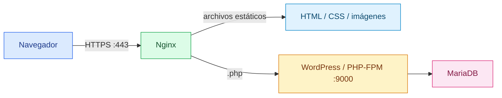
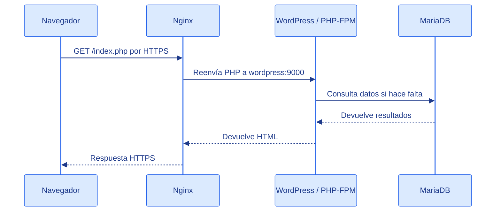

# Nginx

[← README](../README.md)

## Qué es

Nginx es un servidor web.

Su trabajo principal es recibir peticiones de un navegador y devolver una
respuesta. Esa respuesta puede ser un archivo HTML, una imagen, un archivo CSS o
el resultado de una aplicación que vive en otro servicio.

En este proyecto, Nginx es la puerta de entrada del sistema. El usuario no habla
directamente con WordPress ni con MariaDB. El usuario entra por HTTPS y Nginx
decide qué hacer con cada petición.



## Idea simple

Piénsalo como un recepcionista:

1. El navegador llama a `https://ide-dieg.42.fr`.
2. Nginx recibe la petición en el puerto `443`.
3. Si se pide un archivo estático, Nginx lo busca en su carpeta web.
4. Si se pide un archivo PHP, Nginx se lo pasa a WordPress/PHP-FPM.
5. Nginx devuelve al navegador la respuesta final.

## Cómo funciona

Nginx funciona leyendo archivos de configuración. En esos archivos se define:

- En qué puerto escucha.
- Qué nombre de dominio acepta.
- Dónde están los certificados TLS.
- Cuál es la carpeta raíz de la web.
- Qué hacer con cada tipo de ruta.
- A qué servicio reenviar peticiones dinámicas.

El archivo principal de este proyecto es:

```text
srcs/requirements/nginx/conf/nginx.conf
```

La imagen de Docker lo copia aquí dentro del contenedor:

```text
/etc/nginx/http.d/default.conf
```

## Nginx en este proyecto

El contenedor de Nginx se construye con:

```dockerfile
FROM alpine:3.20
RUN apk update && apk add nginx openssl
```

Eso significa que Nginx se instala dentro de una imagen Alpine Linux pequeña.
También se instala OpenSSL porque el proyecto usa HTTPS.

El contenedor expone el puerto:

```dockerfile
EXPOSE 443
```

Y arranca Nginx en primer plano:

```dockerfile
CMD ["nginx", "-g", "daemon off;"]
```

Esto es importante en Docker: el proceso principal del contenedor debe quedarse
ejecutándose. Si Nginx se lanzara como demonio en segundo plano, el contenedor
podría terminar.

## Configuración explicada

```nginx
listen 443 ssl;
listen [::]:443 ssl;
```

Nginx escucha en el puerto `443`, que es el puerto estándar de HTTPS.
La segunda línea hace lo mismo para IPv6.

```nginx
server_name ide-dieg.42.fr;
```

Este es el nombre de dominio esperado para el proyecto. En Inception suele ser
el login seguido de `.42.fr`.

```nginx
ssl_protocols TLSv1.2 TLSv1.3;
```

Solo se aceptan versiones modernas de TLS. TLS es la capa que cifra la conexión
HTTPS.

```nginx
error_page 497 https://$host$request_uri;
```

Si por error se abre `http://ide-dieg.42.fr:443`, el navegador está enviando HTTP
simple al puerto HTTPS. Nginx lo detecta con su código interno `497`. Esta línea
lo redirige a la misma URL usando `https://`.

```nginx
ssl_certificate /etc/nginx/ssl/inception.crt;
ssl_certificate_key /etc/nginx/ssl/inception.key;
```

Estas líneas indican dónde están el certificado público y la clave privada que
usa Nginx para HTTPS.

```nginx
root /usr/share/nginx/html;
index index.php index.html index.htm;
```

`root` es la carpeta donde Nginx busca archivos web. `index` indica qué archivos
probar cuando el usuario entra a una carpeta.

```nginx
location / {
    try_files $uri $uri/ /index.php?$args;
}
```

Para una petición normal, Nginx intenta encontrar el archivo solicitado. Si no lo
encuentra, pasa la petición a `index.php`, que es el punto de entrada de
WordPress.

```nginx
location ~ \.php$ {
    fastcgi_split_path_info ^(.+\.php)(/.+)$;
    fastcgi_pass wordpress:9000;
    fastcgi_index index.php;
    include fastcgi_params;
    fastcgi_param SCRIPT_FILENAME /var/www/html$fastcgi_script_name;
    fastcgi_param PATH_INFO $fastcgi_path_info;
}
```

Este bloque se activa cuando la ruta termina en `.php`.

Nginx no ejecuta PHP por sí mismo. Para eso reenvía la petición al servicio
`wordpress` en el puerto `9000`, donde debería estar escuchando PHP-FPM. PHP-FPM
procesa el archivo PHP y devuelve el resultado a Nginx.

## Flujo de una petición HTTPS

Ejemplo con `https://ide-dieg.42.fr/index.php`:

1. El navegador abre una conexión TLS contra Nginx.
2. Nginx usa `inception.crt` e `inception.key` para cifrar la conexión.
3. Nginx ve que la ruta termina en `.php`.
4. Nginx envía la petición a `wordpress:9000`.
5. PHP-FPM ejecuta `index.php`.
6. WordPress puede consultar MariaDB si necesita datos.
7. PHP-FPM devuelve HTML a Nginx.
8. Nginx devuelve ese HTML al navegador.



## Nota sobre el estado actual del proyecto

El archivo `srcs/docker-compose.yml` ya define los servicios principales:
`nginx`, `wordpress` y `mariadb`.

La configuración de Nginx habla con un servicio llamado
`wordpress`:

```nginx
fastcgi_pass wordpress:9000;
```

Ese nombre funciona porque Docker Compose crea una red donde existe un servicio
llamado `wordpress`. Si arrancas solo el contenedor Nginx de forma aislada,
podrás probar HTTPS y archivos estáticos, pero las rutas PHP pueden fallar con
`502 Bad Gateway` porque no existirá el servicio `wordpress`.

## Ejemplos útiles

Construir y ejecutar desde el Makefile principal:

```sh
make
```

Ese Makefile construye la imagen `nginx` y publica el puerto `443` del
contenedor en el puerto `443` de la máquina.

Probar el módulo de Nginx de forma aislada:

```sh
cd srcs/requirements/nginx
make
```

Ese Makefile publica el puerto `443` del contenedor en el puerto `8088` local.
En ese caso se prueba con:

```sh
curl -k https://localhost:8088
```

La opción `-k` permite usar un certificado autofirmado. Sin esa opción, `curl`
puede rechazar el certificado porque no lo ha emitido una autoridad pública.

Entrar al contenedor:

```sh
docker exec -it nginx sh
```

Comprobar la configuración de Nginx dentro del contenedor:

```sh
nginx -t
```

Ver logs del contenedor:

```sh
docker logs nginx
```

## Errores comunes

Si el navegador muestra una advertencia de seguridad, normalmente es porque el
certificado es autofirmado. Para desarrollo es normal.

Si aparece `404`, Nginx no ha encontrado el archivo solicitado en
`/usr/share/nginx/html`.

Si aparece `502 Bad Gateway`, Nginx ha intentado hablar con `wordpress:9000`,
pero el servicio WordPress/PHP-FPM no está disponible o no responde.

Si aparece `400 Bad Request` con el texto `The plain HTTP request was sent to
HTTPS port`, se ha usado `http://` contra el puerto `443`. Usa
`https://ide-dieg.42.fr`; la configuración también redirige ese caso mediante el
código interno `497`.

Si el dominio `ide-dieg.42.fr` no carga, puede faltar una entrada en `/etc/hosts`
de la máquina host:

```text
127.0.0.1 ide-dieg.42.fr
```
