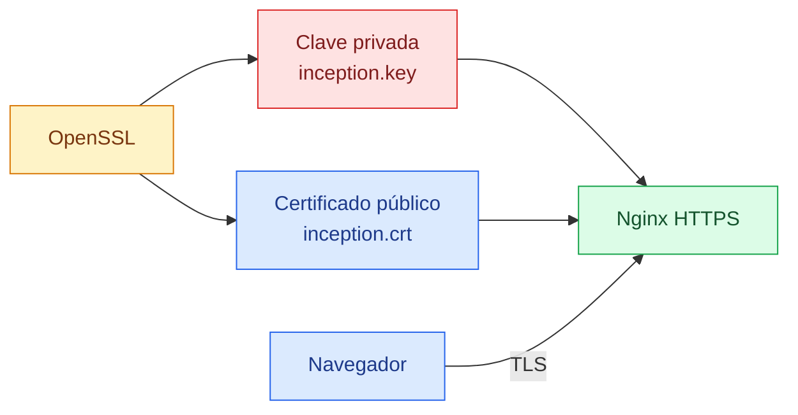
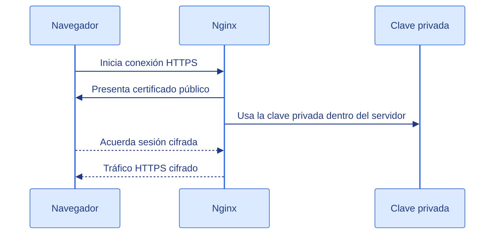

# OpenSSL

[← README](../README.md)

## Qué es

OpenSSL es una herramienta y una librería para trabajar con criptografía.

En palabras simples: sirve para crear claves, certificados y conexiones seguras.
En este proyecto se usa para generar el certificado que permite que Nginx sirva
la web por HTTPS.

## Qué problema resuelve

HTTP normal envía la información sin cifrar. HTTPS usa TLS para cifrar la
conexión entre el navegador y el servidor.

Para que HTTPS funcione, el servidor necesita dos piezas:

- Una clave privada, que debe quedarse dentro del servidor.
- Un certificado público, que el servidor enseña al navegador.

OpenSSL crea esas piezas.



## OpenSSL en este proyecto

El Dockerfile de Nginx instala OpenSSL:

```dockerfile
RUN apk update && apk add nginx openssl
```

Después crea una carpeta para los certificados:

```dockerfile
RUN mkdir -p /run/nginx /etc/nginx/ssl
```

Y genera un certificado autofirmado:

```dockerfile
RUN openssl req -x509 -nodes -days 365 -newkey rsa:2048 \
	-keyout /etc/nginx/ssl/inception.key \
	-out /etc/nginx/ssl/inception.crt \
	-subj "/C=ES/ST=Madrid/L=Madrid/O=42/CN=ide-dieg.42.fr"
```

El resultado son estos dos archivos dentro del contenedor:

```text
/etc/nginx/ssl/inception.key
/etc/nginx/ssl/inception.crt
```

Nginx los usa desde su configuración:

```nginx
ssl_certificate /etc/nginx/ssl/inception.crt;
ssl_certificate_key /etc/nginx/ssl/inception.key;
```

## Explicación del comando

```sh
openssl req
```

`req` trabaja con solicitudes y certificados X.509.

```sh
-x509
```

Crea directamente un certificado X.509 en vez de crear una solicitud para una
autoridad certificadora.

```sh
-nodes
```

Genera la clave privada sin contraseña. En Docker esto evita que Nginx se quede
esperando una contraseña al arrancar.

```sh
-days 365
```

El certificado será válido durante 365 días.

```sh
-newkey rsa:2048
```

Crea una clave nueva RSA de 2048 bits.

```sh
-keyout /etc/nginx/ssl/inception.key
```

Ruta donde se guarda la clave privada.

```sh
-out /etc/nginx/ssl/inception.crt
```

Ruta donde se guarda el certificado público.

```sh
-subj "/C=ES/ST=Madrid/L=Madrid/O=42/CN=ide-dieg.42.fr"
```

Define los datos del certificado sin hacer preguntas interactivas.

El campo más importante aquí es:

```text
CN=ide-dieg.42.fr
```

`CN` significa Common Name. Es el nombre de dominio para el que se genera el
certificado.

## Certificado autofirmado

Un certificado autofirmado está firmado por nosotros mismos, no por una autoridad
certificadora pública.

Para desarrollo y proyectos locales es suficiente. Para producción real, un
navegador no lo considera totalmente fiable y muestra una advertencia de
seguridad.

Por eso, al probar con `curl`, se suele usar:

```sh
curl -k https://localhost:8088
```

La opción `-k` le dice a `curl` que acepte el certificado aunque no pueda
validarlo contra una autoridad conocida.

## Cómo encaja con Nginx

Cuando un navegador entra en `https://ide-dieg.42.fr`:

1. El navegador se conecta al puerto `443`.
2. Nginx presenta el certificado `inception.crt`.
3. Nginx usa la clave privada `inception.key` para completar el inicio seguro de
   la conexión.
4. A partir de ahí, navegador y servidor intercambian datos cifrados.

La clave privada nunca se envía al navegador. Solo se usa dentro del servidor.



## Ejemplos útiles

Ver los datos del certificado dentro del contenedor:

```sh
docker exec -it nginx openssl x509 -in /etc/nginx/ssl/inception.crt -text -noout
```

Ver solo el asunto del certificado:

```sh
docker exec -it nginx openssl x509 -in /etc/nginx/ssl/inception.crt -noout -subject
```

Comprobar fechas de validez:

```sh
docker exec -it nginx openssl x509 -in /etc/nginx/ssl/inception.crt -noout -dates
```

Probar la conexión TLS desde la máquina host:

```sh
openssl s_client -connect localhost:443
```

Si usas el Makefile del directorio `srcs/requirements/nginx`, el puerto local es
`8088`:

```sh
openssl s_client -connect localhost:8088
```

## Errores comunes

Si Nginx dice que no encuentra el certificado, revisa que existan:

```text
/etc/nginx/ssl/inception.crt
/etc/nginx/ssl/inception.key
```

Si el navegador avisa de que el sitio no es seguro, no significa que TLS no
funcione. Significa que el certificado está autofirmado y el navegador no confía
en el emisor.

Si cambias `server_name`, conviene cambiar también el `CN` del certificado para
que ambos nombres coincidan.
