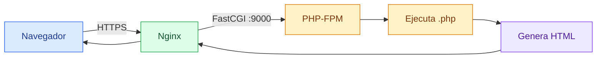

# PHP

[← README](../README.md)

## Qué es

PHP es un lenguaje de programación usado sobre todo para crear páginas web
dinámicas.

Una página HTML normal siempre devuelve el mismo contenido. Una página PHP puede
generar una respuesta distinta según la base de datos, el usuario, la ruta o la
configuración.

WordPress está escrito en PHP. Por eso el contenedor `wordpress` necesita un
motor capaz de ejecutar PHP.

## Idea simple

PHP toma un archivo `.php`, lo ejecuta y genera texto como resultado.

Ese resultado suele ser HTML:

```php
<?php
echo "<h1>Hola desde PHP</h1>";
```

El navegador no recibe el código PHP. El navegador recibe el resultado:

```html
<h1>Hola desde PHP</h1>
```

## Qué es PHP-FPM

PHP-FPM significa FastCGI Process Manager.

En simple: es un proceso que se queda escuchando peticiones para ejecutar PHP.

Nginx no ejecuta PHP directamente. Cuando Nginx encuentra una ruta `.php`, se la
pasa a PHP-FPM. PHP-FPM ejecuta el archivo y devuelve el resultado.



## PHP en este proyecto

PHP vive dentro del contenedor `wordpress`.

El Dockerfile instala:

```dockerfile
php83-fpm php83-mysqli
```

`php83-fpm` instala PHP-FPM para PHP 8.3.

`php83-mysqli` instala la extensión que permite a PHP conectarse a MySQL o
MariaDB. WordPress la necesita para leer y escribir datos.

El contenedor expone el puerto:

```dockerfile
EXPOSE 9000
```

Y arranca PHP-FPM en primer plano:

```dockerfile
CMD ["php-fpm83", "-F"]
```

La opción `-F` hace que PHP-FPM no se mande al fondo. Esto es importante en
Docker: el proceso principal del contenedor debe quedarse ejecutándose.

## Por qué se usa `php83-fpm`

En Alpine Linux, los paquetes de PHP suelen ir versionados.

En `alpine:3.20`, el paquete se llama:

```text
php83-fpm
```

No se usa `php-fpm` porque en esa versión de Alpine no existe como paquete
genérico. Alpine ofrece paquetes concretos como `php82-fpm` o `php83-fpm`.

Por eso también el comando para arrancarlo es:

```text
php-fpm83
```

## Configuración de PHP-FPM

La configuración de PHP-FPM está en:

```text
srcs/requirements/wordpress/conf/php-fpm.conf
```

El Dockerfile la copia dentro del contenedor en:

```text
/etc/php83/php-fpm.d/www.conf
```

La parte más importante es:

```ini
[www]
user = www-data
group = www-data
listen = 0.0.0.0:9000
```

`user` y `group` indican con qué usuario se ejecutan los procesos que atienden
peticiones PHP.

`listen = 0.0.0.0:9000` indica que PHP-FPM escucha en el puerto `9000` dentro
del contenedor. Así Nginx puede conectarse desde otro contenedor de la misma red.

## Cómo se conecta con Nginx

Nginx tiene un bloque para las rutas PHP:

```nginx
location ~ \.php$ {
    fastcgi_pass wordpress:9000;
    fastcgi_param SCRIPT_FILENAME /var/www/html$fastcgi_script_name;
}
```

`fastcgi_pass wordpress:9000` significa:

```text
manda esta petición al servicio wordpress, puerto 9000
```

`SCRIPT_FILENAME` le dice a PHP-FPM qué archivo PHP tiene que ejecutar.

En este proyecto se usa `/var/www/html` porque esa es la ruta de WordPress dentro
del contenedor `wordpress`.

## Qué hace `php83-mysqli`

PHP por sí solo sabe ejecutar código PHP, pero no todas las funciones vienen en
el paquete base.

Para conectar con MariaDB, WordPress necesita una extensión de base de datos.
Aquí se instala:

```text
php83-mysqli
```

Sin esa extensión, WordPress podría arrancar PHP, pero fallaría al intentar
hablar con MariaDB.

## Extensiones que no están instaladas

WordPress suele recomendar más extensiones, por ejemplo:

- `php83-curl`
- `php83-gd`
- `php83-mbstring`
- `php83-xml`
- `php83-zip`

No están instaladas ahora porque el objetivo es mantener la imagen lo más simple
posible.

Eso puede tener efectos:

- Algunos plugins pueden no funcionar.
- La edición o procesamiento de imágenes puede estar limitada.
- WordPress puede mostrar avisos en la salud del sitio.

Para el mínimo del proyecto, las piezas clave son PHP-FPM y conexión a MariaDB.

## Flujo de una petición PHP

Ejemplo con `index.php`:

1. El navegador pide `/index.php`.
2. Nginx recibe la petición por HTTPS.
3. Nginx detecta que termina en `.php`.
4. Nginx envía la petición a `wordpress:9000`.
5. PHP-FPM ejecuta `/var/www/html/index.php`.
6. WordPress puede consultar MariaDB.
7. PHP-FPM devuelve HTML a Nginx.
8. Nginx devuelve HTML al navegador.

## Comandos útiles

Comprobar la versión de PHP-FPM dentro de una imagen:

```sh
docker run --rm inception-wordpress php-fpm83 --version
```

Comprobar que la configuración de PHP-FPM es válida:

```sh
docker run --rm inception-wordpress php-fpm83 -tt
```

Ver módulos PHP cargados:

```sh
docker run --rm inception-wordpress php-fpm83 -m
```

## Errores comunes

Si PHP-FPM no está escuchando en `9000`, Nginx puede responder con `502 Bad
Gateway`.

Si `SCRIPT_FILENAME` apunta a una ruta incorrecta, PHP-FPM puede responder con
`File not found`.

Si falta `php83-mysqli`, WordPress puede cargar PHP pero no podrá conectarse a
MariaDB correctamente.
