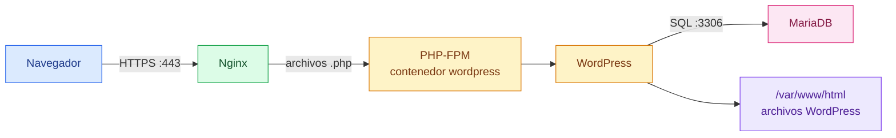
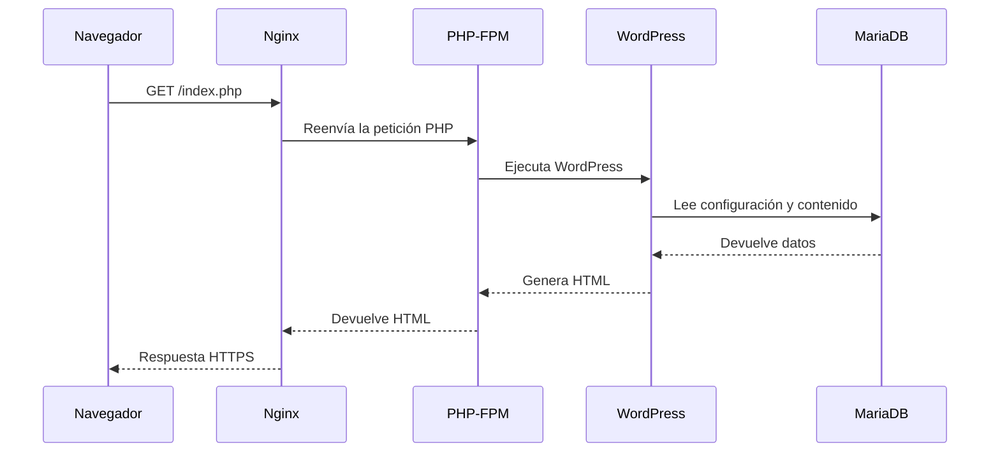

# WordPress

[← README](../README.md)

## Qué es

WordPress es una aplicación web escrita en PHP.

Sirve para crear y gestionar sitios web sin tener que escribir cada página a
mano. WordPress permite tener entradas, páginas, usuarios, temas, plugins,
comentarios y una zona de administración.

En este proyecto, WordPress es la parte dinámica de la web. Nginx recibe las
peticiones HTTPS, pero WordPress es quien genera muchas de las respuestas HTML.

## Idea simple

Piensa en WordPress como el motor de la web:

1. El navegador pide una página.
2. Nginx recibe la petición.
3. Si la petición necesita PHP, Nginx la manda al contenedor `wordpress`.
4. PHP-FPM ejecuta el código de WordPress.
5. WordPress consulta MariaDB si necesita datos.
6. WordPress devuelve HTML.
7. Nginx envía ese HTML al navegador.



## Qué guarda WordPress

WordPress usa dos tipos de información:

- Archivos: el código PHP de WordPress, temas, plugins e imágenes subidas.
- Base de datos: usuarios, entradas, páginas, comentarios y configuración.

En este proyecto los archivos viven en:

```text
/var/www/html
```

Y se comparten con Nginx mediante el volumen `wordpress_data`.

La base de datos estará en MariaDB. WordPress no debería guardar sus datos
principales en el contenedor, porque si el contenedor se recrea se podrían
perder. Por eso se usan volúmenes.

## WordPress en este proyecto

El Dockerfile de WordPress está en:

```text
srcs/requirements/wordpress/Dockerfile
```

La imagen usa Alpine Linux:

```dockerfile
FROM alpine:3.20
```

Instala las piezas mínimas:

```dockerfile
RUN apk add --no-cache ca-certificates curl tar php83 php83-fpm php83-mysqli
```

Cada paquete tiene un papel:

- `ca-certificates`: permite descargar WordPress por HTTPS.
- `curl`: descarga el archivo comprimido de WordPress.
- `tar`: descomprime WordPress.
- `php83`: permite ejecutar pequeñas comprobaciones PHP desde el entrypoint.
- `php83-fpm`: ejecuta el código PHP.
- `php83-mysqli`: permite que WordPress se conecte a MariaDB.

Después descarga WordPress desde su archivo oficial:

```dockerfile
curl -fsSL https://wordpress.org/latest.tar.gz -o /tmp/wordpress.tar.gz
```

Y lo descomprime en:

```text
/usr/src/wordpress
```

Esa carpeta funciona como copia limpia de WordPress dentro de la imagen.

## Por qué existe un entrypoint

El contenedor WordPress monta el volumen `wordpress_data` en:

```text
/var/www/html
```

Cuando Docker monta un volumen vacío sobre esa ruta, el contenido que hubiera en
la imagen puede quedar oculto. Por eso el proyecto usa este script:

```text
srcs/requirements/wordpress/tools/docker-entrypoint.sh
```

La idea es simple:

```sh
if [ ! -f /var/www/html/wp-settings.php ]; then
    cp -a /usr/src/wordpress/. /var/www/html/
fi
```

Si el volumen todavía no tiene WordPress, se copia desde `/usr/src/wordpress` a
`/var/www/html`. Si ya existe, no se pisa.

Esto permite conservar archivos aunque el contenedor se recree.

## Relación con Nginx

Nginx no ejecuta PHP. Solo sabe recibir peticiones web y servir archivos.

Cuando la petición termina en `.php`, Nginx la reenvía al servicio `wordpress`:

```nginx
fastcgi_pass wordpress:9000;
```

Ese nombre funciona porque Docker Compose crea una red interna donde el servicio
`wordpress` se puede resolver por su nombre.

Hay un detalle importante: Nginx ve el volumen en:

```text
/usr/share/nginx/html
```

Pero PHP-FPM lo ve en:

```text
/var/www/html
```

Por eso la ruta que se pasa a PHP-FPM debe apuntar a la ruta del contenedor
WordPress:

```nginx
fastcgi_param SCRIPT_FILENAME /var/www/html$fastcgi_script_name;
```

## Relación con MariaDB

WordPress necesita una base de datos para funcionar de verdad. En este proyecto,
esa base de datos vive en el contenedor `mariadb`.

El nombre de la base, el usuario y las contraseñas se definen en:

```text
srcs/.env
```

Las variables importantes para WordPress son:

- `MYSQL_DATABASE`: nombre de la base de datos de WordPress.
- `MYSQL_USER`: usuario que WordPress usará para entrar en MariaDB.
- `MYSQL_PASSWORD`: contraseña de ese usuario.

Además, `docker-compose.yml` añade `WORDPRESS_DB_HOST=mariadb`. Ese valor le dice
a WordPress que debe buscar la base de datos usando el nombre del servicio
`mariadb` dentro de la red Docker.

WordPress no lee directamente `srcs/.env`. Docker Compose pasa esas variables al
contenedor y el entrypoint genera este archivo:

```text
wp-config.php
```

Ese archivo queda dentro del volumen `wordpress_data`, en:

```text
/var/www/html/wp-config.php
```

El resumen es:

1. MariaDB crea una base llamada `wordpress`.
2. MariaDB crea un usuario llamado `wp_user`.
3. WordPress escribe `wp-config.php` con esos mismos datos.
4. WordPress espera a que MariaDB responda antes de arrancar `php-fpm83`.

## Flujo de una primera visita

Cuando todo esté conectado, una primera visita a `https://ide-dieg.42.fr`
debería seguir este camino:



## Estado actual del servicio

El servicio WordPress ya tiene las piezas básicas:

- Descarga WordPress durante la construcción de la imagen.
- Copia WordPress al volumen si el volumen está vacío.
- Genera `wp-config.php` si todavía no existe.
- Usa las variables de `srcs/.env` para conectar con MariaDB.
- Espera a que MariaDB acepte conexiones antes de arrancar PHP-FPM.
- Arranca `php-fpm83` en primer plano.
- Escucha en el puerto interno `9000`.
- Tiene `php83-mysqli` para poder hablar con MariaDB.

Cuando entras por primera vez a `https://ide-dieg.42.fr`, WordPress ya tiene los
archivos y la conexión a la base de datos preparados. Desde ahí puede crear sus
tablas internas, como `wp_posts`, `wp_users` o `wp_options`, durante la
instalación inicial del sitio.

## Comandos útiles

Construir la imagen de WordPress:

```sh
docker build -t inception-wordpress srcs/requirements/wordpress
```

Comprobar que PHP-FPM lee bien la configuración:

```sh
docker run --rm inception-wordpress php-fpm83 -tt
```

Comprobar que WordPress se copia al directorio web:

```sh
docker run --rm inception-wordpress sh -c "test -f /var/www/html/wp-settings.php"
```

## Errores comunes

Si Nginx muestra `502 Bad Gateway`, normalmente significa que no puede conectar
con PHP-FPM en `wordpress:9000`.

Si aparece `File not found`, puede que Nginx esté enviando a PHP-FPM una ruta que
no existe dentro del contenedor WordPress.

Si WordPress muestra un error de conexión a la base de datos, revisa que
MariaDB haya arrancado, que `srcs/.env` tenga los mismos datos para ambos
contenedores y que exista `/var/www/html/wp-config.php` dentro del volumen.
